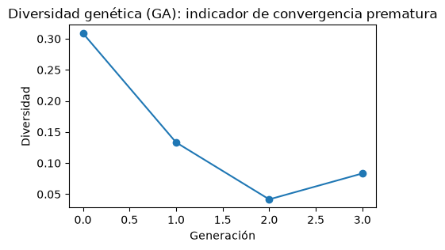

# 03. Desarrollo y prueba del pipeline completo {#nb03}

```{r setup-nb03, include=FALSE}
knitr::opts_chunk$set(python.reticulate = FALSE)
BASE <- if (file.exists(file.path("R", "portar_notebook.R"))) "." else ".."
source(file.path(BASE, "R", "portar_notebook.R"))
```

<!-- nb:md cell=0 -->


Antes de correr los experimentos completos, el pipeline se probó en miniatura con un conjunto de datos sintético de 500 filas (20 variables, 23.4 % de la clase positiva). La prueba confirmó que cada etapa funciona: preprocesamiento (20 variables pasan a 25 tras la codificación *one-hot*), las 4 técnicas de balanceo (ninguna, SMOTE, ADASYN y `class_weight`), los 4 métodos de búsqueda (malla, aleatoria, Optuna y algoritmo genético), la validación cruzada anidada, la calibración y el cálculo de SHAP. También se verificó que la métrica del bucle interno (selección de hiperparámetros) se mantenga separada de la del bucle externo (evaluación), para no mezclar ambas. Los valores obtenidos (por ejemplo, F1 de 0.52 a 0.55 y prueba de Friedman con p = 0.753) son solo de verificación, con pocos datos y pocos pliegues, y no se interpretan como resultados del estudio.

<!-- nb:code cell=1 -->
<details><summary>Código (27 líneas)</summary>

```{python nb03_c01, eval=FALSE}
import sys
from pathlib import Path

PROJECT_ROOT = Path.cwd().parent
if str(PROJECT_ROOT) not in sys.path:
    sys.path.insert(0, str(PROJECT_ROOT))

import numpy as np
import matplotlib.pyplot as plt
from sklearn.model_selection import train_test_split, StratifiedKFold

from src import config
from src.synthetic_data import generate_synthetic_dataset
from src.data_loader import split_features_target
from src.preprocessing import remove_duplicate_rows, get_preprocessing_steps, build_column_transformer
from src.models import MODEL_REGISTRY, get_model_names, get_param_grid
from src.balancing import get_compatible_techniques, build_pipeline
from src.optimization import run_optimization, OPTIMIZATION_METHODS
from src.nested_cv import run_nested_cv
from src.experiment_runner import run_experiments
from src.complexity_analysis import compare_standard_vs_optimized, select_best_fold_index
from src.evaluation import pooled_predictions, pooled_roc_curve, evaluate_calibration, is_calibration_poor
from src import interpretability as ip
from src import stats_comparison as sc

np.random.seed(config.RANDOM_STATE)
config.FIGURES_DIR.mkdir(parents=True, exist_ok=True)
```

</details>

<!-- nb:md cell=2 -->
## 1. Datos sintéticos

<!-- nb:code cell=3 -->
<details><summary>Código (5 líneas)</summary>

```{python nb03_c03, eval=FALSE}
df = generate_synthetic_dataset(n_samples=500)
df, n_removed = remove_duplicate_rows(df)
X, y = split_features_target(df)
print(f"X: {X.shape}, filas duplicadas eliminadas: {n_removed}")
print(f"Balance del target: {y.value_counts(normalize=True).round(3).to_dict()}")
```

</details>

<!-- nb:text cell=3 -->
```text
X: (500, 20), filas duplicadas eliminadas: 0
Balance del target: {0: 0.766, 1: 0.234}
```

<!-- nb:md cell=4 -->
## 2. Preprocesamiento: encoding + scaling condicional

<!-- nb:code cell=5 -->
<details><summary>Código (4 líneas)</summary>

```{python nb03_c05, eval=FALSE}
spec_scaled = MODEL_REGISTRY["logistic_regression"]  # requires_scaling=True
ct = build_column_transformer(apply_scaling=spec_scaled.requires_scaling)
Xt = ct.fit_transform(X)
print(f"Columnas originales: {X.shape[1]} -> transformadas (one-hot + scaling): {Xt.shape[1]}")
```

</details>

<!-- nb:text cell=5 -->
```text
Columnas originales: 20 -> transformadas (one-hot + scaling): 25
```

<!-- nb:md cell=6 -->
## 3. Balanceo: compatibilidad por modelo

<!-- nb:code cell=7 -->
<details><summary>Código (14 líneas)</summary>

```{python nb03_c07, eval=FALSE}
for name, spec in MODEL_REGISTRY.items():
    print(f"  {name}: {get_compatible_techniques(spec)}")

X_train, X_test, y_train, y_test = train_test_split(
    X, y, test_size=0.3, stratify=y, random_state=config.RANDOM_STATE
)

demo_spec = MODEL_REGISTRY["decision_tree"]
for technique in get_compatible_techniques(demo_spec):
    steps = get_preprocessing_steps(demo_spec)
    pipe = build_pipeline(demo_spec, technique, y_train=y_train, preprocessing_steps=steps)
    pipe.fit(X_train, y_train)
    assert len(pipe.predict(X_test)) == len(X_test)
print(f"\nOK: {demo_spec.name} entrenado con sus {len(get_compatible_techniques(demo_spec))} técnicas compatibles.")
```

</details>

<!-- nb:text cell=7 -->
```text
  knn: ['none', 'smote', 'adasyn', 'class_weight']
  naive_bayes: ['none', 'smote', 'adasyn', 'class_weight']
  logistic_regression: ['none', 'smote', 'adasyn', 'class_weight']
  decision_tree: ['none', 'smote', 'adasyn', 'class_weight']
  random_forest: ['none', 'smote', 'adasyn', 'class_weight']
  xgboost: ['none', 'smote', 'adasyn', 'class_weight']
  svm: ['none', 'smote', 'adasyn', 'class_weight']

OK: decision_tree entrenado con sus 4 técnicas compatibles.
```

<!-- nb:md cell=8 -->
## 4. Modelos base y espacios de búsqueda

<!-- nb:code cell=9 -->
<details><summary>Código (2 líneas)</summary>

```{python nb03_c09, eval=FALSE}
print("Modelos registrados:", get_model_names())
print("param_grid (decision_tree):", get_param_grid(demo_spec))
```

</details>

<!-- nb:text cell=9 -->
```text
Modelos registrados: ['knn', 'naive_bayes', 'logistic_regression', 'decision_tree', 'random_forest', 'xgboost', 'svm']
param_grid (decision_tree): {'max_depth': [2, 11, 21, 30], 'min_samples_split': [2, 18, 34, 50], 'min_samples_leaf': [1, 7, 14, 20], 'criterion': ['gini', 'entropy']}
```

<!-- nb:md cell=10 -->
## 5. Optimización: los 4 métodos, en miniatura

<!-- nb:code cell=11 -->
<details><summary>Código (17 líneas)</summary>

```{python nb03_c11, eval=FALSE}
inner_cv = StratifiedKFold(n_splits=2, shuffle=True, random_state=config.RANDOM_STATE)
opt_kwargs = {
    "grid_search": {},
    "random_search": {"n_iter": 5},
    "bayesian_optuna": {"n_trials": 5},
    "genetic_deap": {"population_size": 6, "n_generations": 3},
}

ga_diversity = None
for method in OPTIMIZATION_METHODS:
    result = run_optimization(
        method, demo_spec, "class_weight", X_train, y_train, inner_cv,
        preprocessing_steps=get_preprocessing_steps(demo_spec), **opt_kwargs[method],
    )
    print(f"  {method}: best_score={result.best_score:.4f}, n_evaluations={result.n_evaluations}")
    if method == "genetic_deap":
        ga_diversity = result.diagnostics["diversity_history"]
```

</details>

<!-- nb:text cell=11 -->
```text
  grid_search: best_score=0.5571, n_evaluations=128
  random_search: best_score=0.5596, n_evaluations=5
  bayesian_optuna: best_score=0.5475, n_evaluations=5
  genetic_deap: best_score=0.5685, n_evaluations=12
```

<!-- nb:code cell=12 -->
<details><summary>Código (6 líneas)</summary>

```{python nb03_c12, eval=FALSE}
fig, ax = plt.subplots(figsize=(5, 3))
ax.plot(ga_diversity, marker="o")
ax.set_xlabel("Generación"); ax.set_ylabel("Diversidad")
ax.set_title("Diversidad genética (GA): indicador de convergencia prematura")
plt.savefig(config.FIGURES_DIR / "dev_ga_diversity.png", dpi=100, bbox_inches="tight")
plt.show()
```

</details>

<!-- nb:img cell=12 -->


<!-- nb:md cell=13 -->
## 6. Validación cruzada anidada: inner vs. outer

<!-- nb:code cell=14 -->
<details><summary>Código (10 líneas)</summary>

```{python nb03_c14, eval=FALSE}
ncv_result = run_nested_cv(
    demo_spec, "class_weight", "random_search", X, y,
    n_outer_folds=2, n_inner_folds=2, optimizer_kwargs={"n_iter": 5},
)
for fr in ncv_result.fold_results:
    print(
        f"  fold {fr.fold_index}: inner_best_score={fr.inner_best_score:.4f}  "
        f"outer f1={fr.metrics['f1']:.4f}  (nunca confundir estos dos)"
    )
print("metrics_summary:", {k: (round(v[0], 4), round(v[1], 4)) for k, v in ncv_result.metrics_summary.items()})
```

</details>

<!-- nb:text cell=14 -->
```text
  fold 0: inner_best_score=0.4070  outer f1=0.5032  (nunca confundir estos dos)
  fold 1: inner_best_score=0.5680  outer f1=0.5333  (nunca confundir estos dos)
metrics_summary: {'accuracy': (0.72, 0.028), 'precision': (0.4379, 0.0358), 'recall': (0.6413, 0.0311), 'f1': (0.5183, 0.0151), 'roc_auc': (0.7229, 0.015)}
```

<!-- nb:md cell=15 -->
## 7. Orquestador: unas pocas combinaciones

<!-- nb:code cell=16 -->
<details><summary>Código (13 líneas)</summary>

```{python nb03_c16, eval=FALSE}
# Nota: los warnings de LogisticRegression guardados en la salida (`penalty` deprecado desde sklearn 1.8, se elimina en 1.10) quedaron sin corregir;
# conviene migrar a `l1_ratio` (l1_ratio=0 en lugar de penalty='l2', l1_ratio=1 en lugar de 'l1').
dev_checkpoint = config.RESULTS_DIR / "dev_pipeline_check.csv"

models_dev = [MODEL_REGISTRY["decision_tree"], MODEL_REGISTRY["logistic_regression"]]
table, results = run_experiments(
    X, y,
    models=models_dev, techniques=["none", "class_weight"], methods=["random_search"],
    n_outer_folds=2, n_inner_folds=2,
    optimizer_kwargs_by_method={"random_search": {"n_iter": 5}},
    checkpoint_path=dev_checkpoint, resume=False, n_jobs=1,
)
table[["model", "technique", "method", "f1_mean", "f1_std"]]
```

</details>

<!-- nb:text cell=16 -->
```text
[experiment_runner] 4 combinaciones a ejecutar.
[experiment_runner] OK logistic_regression/none/random_search: f1=0.5299±0.0415 (0.5s)
[experiment_runner] OK logistic_regression/class_weight/random_search: f1=0.5524±0.0402 (0.4s)
[experiment_runner] OK decision_tree/none/random_search: f1=0.5547±0.0547 (0.3s)
[experiment_runner] OK decision_tree/class_weight/random_search: f1=0.5183±0.0151 (0.3s)
```

<!-- nb:table cell=16 -->
```{r nb03_t16_1, echo=FALSE}
mostrar_tabla("03_pipeline_dev", "cell16_1.csv")
```

<!-- nb:md cell=17 -->
## 8. Complejidad computacional: estándar vs. optimizado

<!-- nb:code cell=18 -->
<details><summary>Código (8 líneas)</summary>

```{python nb03_c18, eval=FALSE}
dt_result = results[("decision_tree", "class_weight", "random_search")]
fold_idx = select_best_fold_index(dt_result, metric="f1")
best_params = dt_result.fold_results[fold_idx].best_params

complexity_row = compare_standard_vs_optimized(
    MODEL_REGISTRY["decision_tree"], "class_weight", best_params, X, y, fold_idx, n_outer_folds=2,
)
print(f"Cambio en desempeño (optimizado - estándar): {complexity_row['performance_change']:.4f}")
```

</details>

<!-- nb:text cell=18 -->
```text
Cambio en desempeño (optimizado - estándar): 0.0379
```

<!-- nb:md cell=19 -->
## 9. Evaluación y calibración

<!-- nb:code cell=20 -->
<details><summary>Código (7 líneas)</summary>

```{python nb03_c20, eval=FALSE}
# Nota: el Brier de 0.2087 es peor que el de un predictor constante (≈0.179 con 23.4% de positivos: 0.234 * 0.766), y el ECE confirma la mala calibración.
y_true_p, y_pred_p, y_proba_p = pooled_predictions(dt_result)
roc = pooled_roc_curve(dt_result)
calib = evaluate_calibration(y_true_p, y_proba_p, n_bins=5)

print(f"AUC (out-of-fold pooleado): {roc['auc']:.4f}")
print(f"Brier: {calib['brier_score']:.4f}  ECE: {calib['ece']:.4f}  (deficiente: {is_calibration_poor(calib['ece'])})")
```

</details>

<!-- nb:text cell=20 -->
```text
AUC (out-of-fold pooleado): 0.7231
Brier: 0.2087  ECE: 0.2208  (deficiente: True)
```

<!-- nb:md cell=21 -->
## 10. Interpretabilidad: SHAP rápido

<!-- nb:code cell=22 -->
<details><summary>Código (11 líneas)</summary>

```{python nb03_c22, eval=FALSE}
fitted = ip.fit_explainable_pipeline(
    MODEL_REGISTRY["decision_tree"], "class_weight", best_params, X, y, fold_idx, n_outer_folds=2
)
model_step = fitted["pipeline"].named_steps["model"]
n_explain = min(50, fitted["X_test_t"].shape[0])

shap_values, base_value = ip.compute_shap_values(
    "decision_tree", model_step, fitted["X_train_t"], fitted["X_test_t"][:n_explain]
)
agg_values, agg_names = ip.aggregate_onehot_shap(shap_values, fitted["feature_names"])
print(f"SHAP agregado: {agg_values.shape}, primeras features: {agg_names[:5]}")
```

</details>

<!-- nb:text cell=22 -->
```text
SHAP agregado: (50, 20), primeras features: ['SEX', 'EDUCATION', 'MARRIAGE', 'feature_0', 'feature_2']
```

<!-- nb:md cell=23 -->
## 11. Comparación estadística jerárquica

<!-- nb:code cell=24 -->
<details><summary>Código (6 líneas)</summary>

```{python nb03_c24, eval=FALSE}
# Nota: el mensaje guardado en la salida dice N_OUTER_FOLDS=3 (valor de config, escrito en src/stats_comparison.py), pero esta corrida de desarrollo usó 2 folds externos (n_outer_folds=2).
comparison = sc.run_hierarchical_comparison(results, metric="f1", top_k_for_delong=2)
friedman = comparison["friedman"]
print(f"Friedman: p={friedman['p_value']:.4f}, significativo={friedman['significant']}")
if not friedman["significant"]:
    print(comparison.get("stage_2_note", ""))
```

</details>

<!-- nb:text cell=24 -->
```text
Friedman: p=0.7530, significativo=False
Friedman no significativo (p=0.7530 >= alpha=0.05): no se reporta evidencia de superioridad de ninguna combinación. Dado que N_OUTER_FOLDS=3 (pocos bloques), esto puede reflejar falta de potencia estadística tanto como equivalencia real, ver limitación documentada en el docstring del módulo.
```
