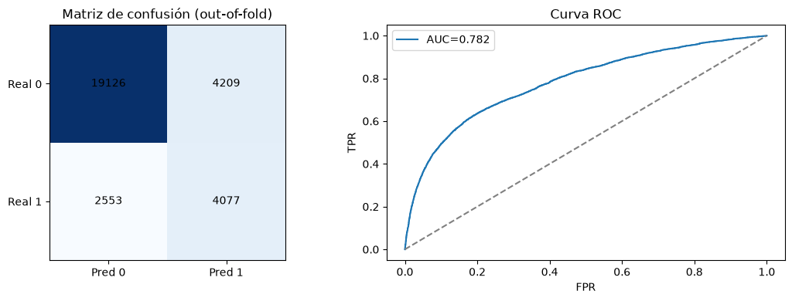
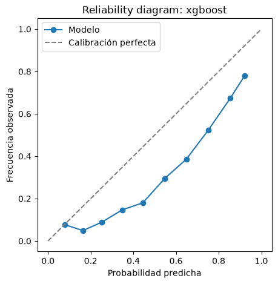
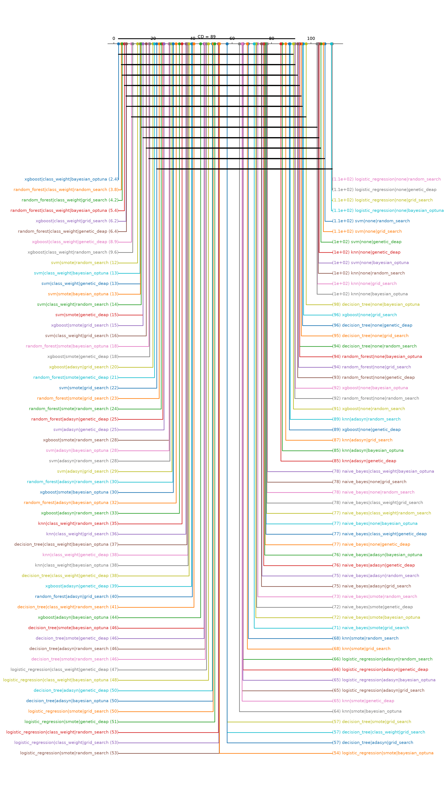
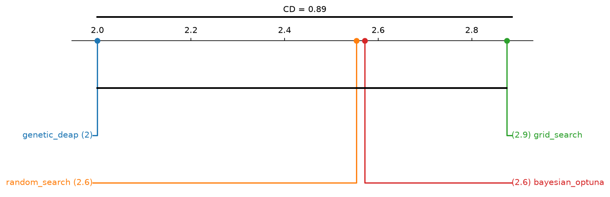
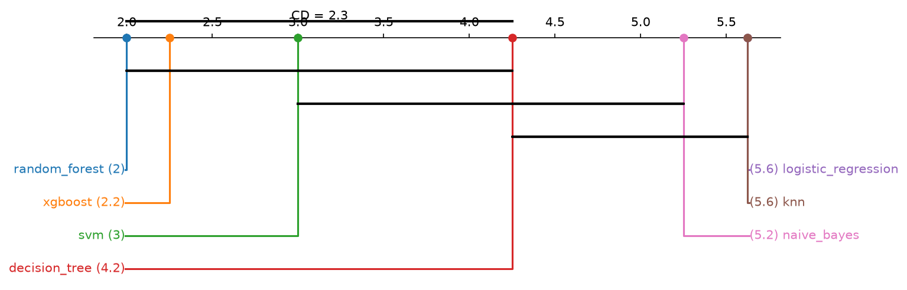
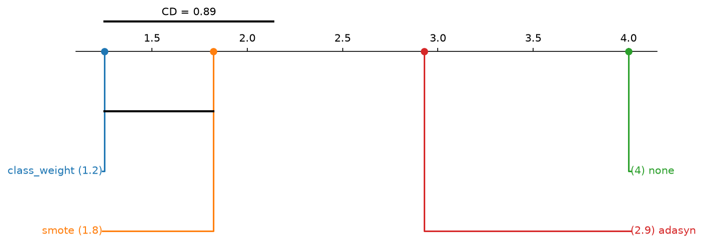
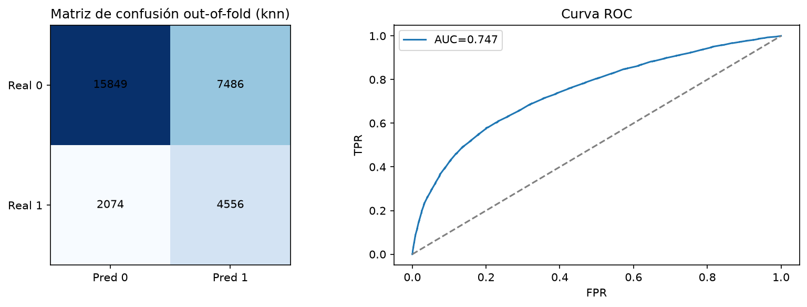
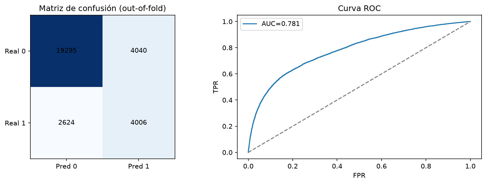
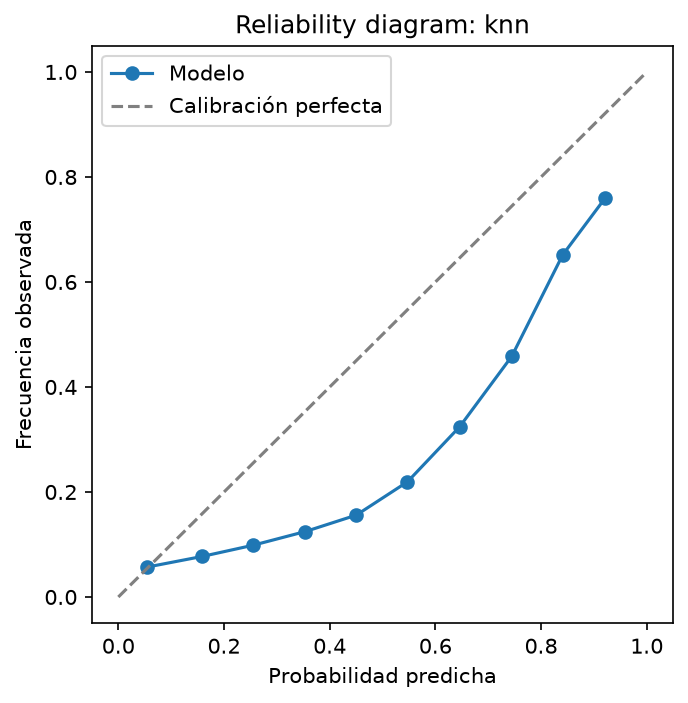
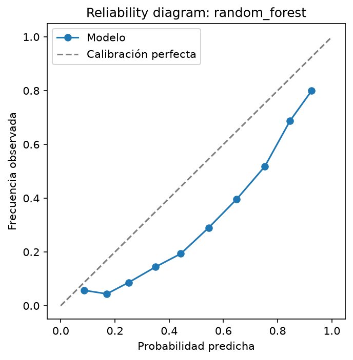

# 05. Análisis de resultados {#nb05}

```{r setup-nb05, include=FALSE}
knitr::opts_chunk$set(python.reticulate = FALSE)
BASE <- if (file.exists(file.path("R", "portar_notebook.R"))) "." else ".."
source(file.path(BASE, "R", "portar_notebook.R"))
```

<!-- nb:md cell=0 -->

Este capítulo ejecuta la fase de evaluación cuantitativa del pipeline experimental sobre la tabla maestra de las 112 combinaciones (96 filas de CPU local y de KNN en GPU, más 16 filas de SVM en GPU), todas de la validación anidada 5 x 5.

### Objetivo prioritario:
Dado que la **métrica clave definida para este problema es el $F_1$-score**, la evaluación prioriza la maximización de la media armónica entre la Precisión ($\text{Precision}$) y la Sensibilidad ($\text{Recall}$). Esto es crítico en escenarios donde existe un desbalance de clases relevante y se busca un equilibrio óptimo entre minimizar los falsos negativos y controlar la tasa de falsos positivos, garantizando una detección robusta y confiable.

---

**Contenido:** 
* Tabla de métricas resumidas ($\text{media} \pm \text{desviación estándar}$ en el *outer loop*).
* Métricas complementarias (ROC-AUC, PR-AUC; $F_1$ sigue siendo la principal) y desviaciones con `ddof=1`.
* Comparación estadística jerárquica (Friedman, Nemenyi, CD diagram, DeLong con corrección Holm, Cliff's Delta), con carácter descriptivo por las limitaciones indicadas en esa sección, más una comparación por factor (técnica, método, modelo) que sí tiene potencia.
* Matriz de confusión y curva ROC de la combinación con mayor $F_1$-score medio.
* Diagnóstico de calibración probabilística (Brier score, ECE y *reliability diagram*) + recalibración por regresión isotónica.
* Análisis de complejidad computacional y *trade-off* de recursos (estándar vs. optimizado).

<!-- nb:code cell=1 -->
<details><summary>Código (31 líneas)</summary>

```{python nb05_c01, eval=FALSE}
import sys
from pathlib import Path

PROJECT_ROOT = Path.cwd().parent
if str(PROJECT_ROOT) not in sys.path:
    sys.path.insert(0, str(PROJECT_ROOT))

import json

import numpy as np
import matplotlib.pyplot as plt
from sklearn.metrics import confusion_matrix, roc_curve, roc_auc_score

from src import config
from src.data_loader import load_processed_dataset, split_features_target
from src.synthetic_data import generate_synthetic_dataset
from src.preprocessing import remove_duplicate_rows
from src.models import MODEL_REGISTRY
from src.experiment_runner import load_master_table
from src.evaluation import (
    format_metrics_table,
    regenerate_outof_fold_predictions,
    evaluate_calibration,
    is_calibration_poor,
    assess_and_recalibrate,
)
from src.complexity_analysis import compare_standard_vs_optimized, TRAIN_INFERENCE_COMPLEXITY
from src import stats_comparison as sc

np.random.seed(config.RANDOM_STATE)
config.FIGURES_DIR.mkdir(parents=True, exist_ok=True)
```

</details>

<!-- nb:md cell=2 -->
## Cargar datos y tabla maestra

Se carga el dataset procesado garantizando la reproducibilidad del orden de los datos y se consolida la tabla maestra combinada.

**Nota de comparabilidad de las filas de SVM (Colab).** Se verificó en el capítulo 08: al reajustar con `sklearn.svm.SVC` en CPU los hiperparámetros elegidos en Colab, el F1 sube entre unas milésimas y 0.02 según la combinación, así que las filas de Colab subestiman a SVM (ver el detalle en el capítulo 08). Las 16 filas de `svm` (y las 16 de `knn`, que también corrieron en Colab) no son estrictamente comparables con las 80 de la CPU local:
- SVM usó `cuml.svm.SVC` y KNN la búsqueda de vecinos de cuML, en una GPU T4 de Colab (RAPIDS 26.06), no `sklearn` en CPU. El solver y la calibración de probabilidades (Platt) de SVM no son idénticos; en KNN las predicciones de clase coinciden con las de scikit-learn en 99.98 % a 100 % de los casos, pero las probabilidades difieren por precisión float32 y empates (diferencia máxima de F1 por fold de unos 0.007).
- No se guardan los índices de los folds. Con el mismo `random_state=42` y el mismo dataset los folds deberían coincidir, pero no se puede verificar fila a fila.
- Los tiempos de SVM y de KNN (GPU, otro hardware) no son comparables con los de los demás modelos (CPU local).
- Las filas `knn|class_weight` y `naive_bayes|class_weight` usan implementaciones propias, no el soporte nativo de scikit-learn.
- Las desviaciones estándar de la tabla maestra se calculan con `ddof=1` (5 folds externos).

<!-- nb:code cell=3 -->
<details><summary>Código (27 líneas)</summary>

```{python nb05_c03, eval=FALSE}
import pandas as pd

try:
    df = load_processed_dataset()
except FileNotFoundError:
    df = generate_synthetic_dataset()
df, _ = remove_duplicate_rows(df)
X, y = split_features_target(df)

# 1. Cargar la tabla maestra principal
table_master = load_master_table(config.EXPERIMENTS_MASTER_PATH)

# 2. Cargar la tabla adicional de SVM desde Colab
colab_csv_path = config.SVM_COLAB_PATH  # SVM 5 x 5 (cuML en GPU); la corrida 3 x 3 está en results/legacy_3x3/

if colab_csv_path.exists():
    table_colab = load_master_table(colab_csv_path)
    # Concatenar ambas tablas y eliminar duplicados basados en combinación única
    table = pd.concat([table_master, table_colab], ignore_index=True)
    table = table.drop_duplicates(subset=["model", "technique", "method"], keep="last")
else:
    table = table_master

if table.empty:
    raise RuntimeError("La tabla maestra está vacía. Correr primero 04_run_experiments.ipynb o verificar los CSVs.")

print(f"{len(table)} combinaciones en la tabla maestra combinada.")
```

</details>

<!-- nb:text cell=3 -->
```text
112 combinaciones en la tabla maestra combinada.
```

<!-- nb:md cell=4 -->
## Tabla de métricas (media y desviación estándar, outer loop)

<!-- nb:code cell=5 -->
<details><summary>Código (3 líneas)</summary>

```{python nb05_c05, eval=FALSE}
metric_for_ranking = config.DEFAULT_SCORING
table_sorted = table.sort_values(f"{metric_for_ranking}_mean", ascending=False)
format_metrics_table(table_sorted)
```

</details>

<!-- nb:table cell=5 -->
```{r nb05_t05_1, echo=FALSE}
mostrar_tabla("05_results_analysis", "cell05_1.csv")
```

<!-- nb:md cell=6 -->
Cambiando el parámetro de ranking a **`f1`**, la tabla posiciona en los primeros lugares los modelos con mejor balance armónico entre precisión y recall:

Hallazgos bajo F1 Score (descriptivos):
- El modelo **`xgboost`** combinado con **`class_weight`** y optimizado mediante **`bayesian_optuna`** tiene el **F1 Score medio más alto del experimento: $0.5466 \pm 0.0082$** (la tabla de arriba usa `ddof=0`; con `ddof=1` es 0.0091).
- Le siguen `random_forest` con `class_weight` ($0.5452$ mediante `random_search`, $0.5448$ mediante `grid_search`). Las diferencias con la primera (0.0014 y 0.0018) son mucho menores que la desviación estándar entre folds (0.009): 14 de las 112 combinaciones quedan a menos de una desviación estándar de ella. El orden entre ellas es descriptivo y no indica una mejor configuración (ver comparación estadística más abajo).
- La aplicación de técnicas de balanceo como `class_weight` aumenta el F1 Score frente a las configuraciones sin balanceo (`none`), que presentan un F1 menor por su baja sensibilidad: el recall medio por técnica pasa de 0.37 (`none`) a 0.61 (`class_weight`) sobre las 112 combinaciones.
- Esa mejora viene en gran parte del balanceo y del umbral de decisión (0.5), no de una mejor capacidad para ordenar clientes. En regresión logística, el F1 pasa de 0.378 (`none`) a 0.516 (SMOTE o `class_weight`) y el recall de 0.27 a 0.62, mientras que el ROC-AUC casi no cambia (0.7496 sin balanceo, 0.748 con SMOTE o `class_weight`). Entre todas las combinaciones, el ROC-AUC medio por técnica queda entre 0.752 y 0.763.

<!-- nb:md cell=7 -->
## Métricas complementarias (independientes del umbral)

El $F_1$ sigue siendo la métrica principal: es la que optimizan los cuatro métodos de búsqueda y la que ordena todo el análisis. Se agregan, solo para reportar, el ROC-AUC y el PR-AUC (*average precision*), que miden qué tan bien ordena el modelo a los clientes sin depender del umbral de 0.5, y se recalcula la desviación estándar entre folds con `ddof=1` (la columna `*_std` de la tabla maestra ya usa `ddof=1`; aquí se recalcula como verificación).

El PR-AUC no estaba en la corrida original. Se calcula a posteriori: se reajusta cada pipeline con los hiperparámetros ya elegidos en cada fold externo (un `fit` por fold, sin nueva búsqueda) y se comprueba que el $F_1$ por fold coincide con el de la tabla maestra. **No incluye SVM**: sus filas vienen de cuML en GPU; su PR-AUC se obtiene en el capítulo 08 reajustando con `sklearn.svm.SVC`. Las filas de KNN (GPU) sí se reajustan aquí con scikit-learn.

<!-- nb:code cell=8 -->
<details><summary>Código (25 líneas)</summary>

```{python nb05_c08, eval=FALSE}
from src.posthoc_metrics import POSTHOC_METRICS_PATH
from src.stats_comparison import per_fold_std

posthoc = pd.read_csv(POSTHOC_METRICS_PATH) if POSTHOC_METRICS_PATH.exists() else pd.DataFrame()
key = ["model", "technique", "method"]
table_ext = table.copy()
table_ext["f1_std_ddof1"] = per_fold_std(table_ext, "f1")
if not posthoc.empty:
    table_ext = table_ext.merge(
        posthoc[key + ["f1_check_max_abs_diff", "pr_auc_posthoc_mean", "pr_auc_posthoc_std"]], on=key, how="left"
    )
    print(f"PR-AUC calculado para {posthoc.shape[0]} combinaciones; "
          f"diferencia máxima en F1 por fold frente a la tabla maestra: {posthoc['f1_check_max_abs_diff'].max():.2e}")
else:
    print("Falta results/experiments_posthoc_metrics.csv: correr `python -m src.posthoc_metrics`.")

cols = ["model", "technique", "method", "f1_mean", "f1_std_ddof1", "precision_mean", "recall_mean", "roc_auc_mean"]
if "pr_auc_posthoc_mean" in table_ext:
    cols += ["pr_auc_posthoc_mean"]
display(table_ext.sort_values("f1_mean", ascending=False)[cols].head(15).round(4))

print("Promedio por técnica de balanceo (las 96 combinaciones locales; SVM no tiene PR-AUC):")
agg = ["f1_mean", "precision_mean", "recall_mean", "roc_auc_mean"] + (["pr_auc_posthoc_mean"] if "pr_auc_posthoc_mean" in table_ext else [])
sub_local = table_ext[table_ext["model"] != "svm"]
display(sub_local.groupby("technique")[agg].mean().sort_values("f1_mean", ascending=False).round(4))
```

</details>

<!-- nb:text cell=8 -->
```text
PR-AUC calculado para 96 combinaciones; diferencia máxima en F1 por fold frente a la tabla maestra: 6.55e-03
```

<!-- nb:table cell=8 -->
```{r nb05_t08_1, echo=FALSE}
mostrar_tabla("05_results_analysis", "cell08_1.csv")
```

<!-- nb:text cell=8 -->
```text
Promedio por técnica de balanceo (las 96 combinaciones locales; SVM no tiene PR-AUC):
```

<!-- nb:table cell=8 -->
```{r nb05_t08_2, echo=FALSE}
mostrar_tabla("05_results_analysis", "cell08_2.csv")
```

<!-- nb:md cell=9 -->
El $F_1$ lo lideran XGBoost y Random Forest con `class_weight` (0.543 a 0.547 las cinco primeras; desviación entre folds con `ddof=1` de 0.008 a 0.011). Sobre las 96 combinaciones locales, el balanceo cambia el punto de operación más que la capacidad de ordenar: sin balanceo el ROC-AUC medio (0.759) es mayor que con SMOTE (0.754) o ADASYN (0.750), y su PR-AUC (0.516) es mayor que con SMOTE (0.510) o ADASYN (0.503); solo `class_weight` mejora algo en ambos (0.762 y 0.519). Lo que sí cambia es el equilibrio entre recall y precisión al umbral de 0.5: el recall pasa de 0.378 (`none`) a 0.607 (`class_weight`) y la precisión baja de 0.621 a 0.464. Por eso la ganancia de $F_1$ al balancear (de 0.458 a 0.524) viene en gran parte del umbral y no de un modelo que discrimine mejor, lo que es coherente con que el $F_1$ siga siendo la métrica principal siempre que se lea así. Las diferencias de PR-AUC entre las ocho primeras combinaciones (0.548 a 0.562) son del orden de su variabilidad entre folds.

<!-- nb:md cell=10 -->
## Cobertura de la grilla: 112 combinaciones teóricas

Se documenta la matriz completa de 112 combinaciones teóricas (7 clasificadores $\times$ 4 técnicas de balanceo $\times$ 4 métodos de búsqueda) para fines de auditoría y cobertura experimental.

<!-- nb:code cell=11 -->
<details><summary>Código (24 líneas)</summary>

```{python nb05_c11, eval=FALSE}
import pandas as pd
from src.balancing import BALANCING_TECHNIQUES, is_compatible
from src.optimization import OPTIMIZATION_METHODS

filas_teoricas = [
    (model_name, technique, method, is_compatible(spec, technique))
    for model_name, spec in MODEL_REGISTRY.items()
    for technique in BALANCING_TECHNIQUES
    for method in OPTIMIZATION_METHODS
]
reporte_112 = pd.DataFrame(filas_teoricas, columns=["model", "technique", "method", "compatible"])
reporte_112 = reporte_112.merge(
    table[["model", "technique", "method", f"{metric_for_ranking}_mean"]],
    on=["model", "technique", "method"], how="left",
)
reporte_112["estado"] = np.where(
    ~reporte_112["compatible"],
    "No aplica (sklearn no admite class_weight para este modelo)",
    np.where(reporte_112[f"{metric_for_ranking}_mean"].notna(), "Corrida", "Pendiente"),
)

print(f"Total de combinaciones teóricas: {len(reporte_112)}")
print(reporte_112["estado"].value_counts().to_string())
reporte_112.drop(columns="compatible").sort_values(["estado", "model", "technique", "method"])
```

</details>

<!-- nb:text cell=11 -->
```text
Total de combinaciones teóricas: 112
estado
Corrida    112
```

<!-- nb:table cell=11 -->
```{r nb05_t11_1, echo=FALSE}
mostrar_tabla("05_results_analysis", "cell11_1.csv")
```

<!-- nb:md cell=12 -->
## Comparación estadística jerárquica

Se aplica sobre las 112 combinaciones, con los 5 folds externos como bloques y el $F1\,Score$ como métrica. Los resultados deben leerse como evidencia **descriptiva**, no inferencial (ver limitación común al final):
1. **Prueba ómnibus de Friedman:** contrasta si todas las combinaciones son equivalentes en F1. Con $\chi^2 \approx 535$ ($p \approx 10^{-52}$) solo indica que no todas son iguales; no dice cuáles difieren.
2. **Nemenyi y diagrama de diferencia crítica (CD):** con 112 combinaciones y 5 folds la diferencia crítica es 89.4, menor que la máxima diferencia observada entre rangos medios (108.3). Solo los pares más alejados se separan: 224 de 6,216 son significativos, y 90 combinaciones quedan a menos de una diferencia crítica de la primera. El diagrama separa los extremos del ranking, pero no ordena las combinaciones del grupo de cabeza.
3. **DeLong (top 3 por F1):** compara el AUC (no el F1) de las tres combinaciones con mejor rango en F1. Se calcula sobre predicciones *out-of-fold* agrupadas, que provienen de cinco modelos distintos (uno por fold), por lo que el AUC agrupado no coincide con `roc_auc_mean` (por ejemplo, 0.7819 frente a 0.7828 en `xgboost|class_weight|bayesian_optuna`). Además, elegir las combinaciones por F1 y compararlas en AUC introduce un sesgo de selección.
4. **Cliff's Delta:** con 5 folds hay 25 pares por comparación, algo más que con 3 pero aún pocos para que el tamaño del efecto sea más que orientativo.

**Limitación común:** los conjuntos de entrenamiento de los folds se solapan, así que los folds no son bloques independientes y los p-valores resultan optimistas.

<!-- nb:code cell=13 -->
<details><summary>Código (11 líneas)</summary>

```{python nb05_c13, eval=FALSE}
comparison = sc.run_hierarchical_comparison_from_table(
    table, X, y, metric=metric_for_ranking, top_k_for_delong=3
)

friedman = comparison["friedman"]
print(
    f"Friedman: estadístico={friedman['statistic']:.4f}, p={friedman['p_value']:.4f}, "
    f"significativo={friedman['significant']} (alpha={friedman['alpha']}, "
    f"{friedman['n_blocks']} folds, {friedman['k_combinations']} combinaciones; {friedman['n_tied_in_avg_ranks']} con rango medio empatado, desempatadas por F1 medio)"
)
friedman["avg_ranks"]
```

</details>

<!-- nb:text cell=13 -->
```text
Friedman: estadístico=534.6002, p=0.0000, significativo=True (alpha=0.05, 5 folds, 112 combinaciones; 21 con rango medio empatado, desempatadas por F1 medio)
xgboost|class_weight|bayesian_optuna            2.4
random_forest|class_weight|random_search        3.8
random_forest|class_weight|grid_search          4.2
random_forest|class_weight|bayesian_optuna      5.4
xgboost|class_weight|grid_search                6.2
                                              ...
svm|none|random_search                        107.0
logistic_regression|none|bayesian_optuna      110.3
logistic_regression|none|grid_search          110.3
logistic_regression|none|genetic_deap         110.7
logistic_regression|none|random_search        110.7
Length: 112, dtype: float64
```

<!-- nb:code cell=14 -->
<details><summary>Código (15 líneas)</summary>

```{python nb05_c14, eval=FALSE}
if comparison["friedman"]["significant"]:
    sc.plot_cd_diagram(
        comparison["friedman"]["avg_ranks"],
        comparison["nemenyi_p_matrix"],
        cd=comparison["critical_difference"],
        save_path=str(config.FIGURES_DIR / "cd_diagram.png"),
    )
    print(f"Diferencia Crítica (CD): {comparison['critical_difference']:.4f}")
    print(f"Top-{len(comparison['top_combos'])} para DeLong: {comparison['top_combos']}")
    print("\nDeLong (pares dentro del top, corrección Holm):")
    display(comparison["delong_comparisons"])
    print("\nCliff's Delta (tamaño del efecto, ver limitación de N_OUTER_FOLDS pequeño en el docstring):")
    display(comparison["cliffs_delta"])
else:
    print(comparison["stage_2_note"])
```

</details>

<!-- nb:text cell=14 -->
```text
Diferencia Crítica (CD): 89.3721
Top-3 para DeLong: ['xgboost|class_weight|bayesian_optuna', 'random_forest|class_weight|random_search', 'random_forest|class_weight|grid_search']

DeLong (pares dentro del top, corrección Holm):
```

<!-- nb:table cell=14 -->
```{r nb05_t14_1, echo=FALSE}
mostrar_tabla("05_results_analysis", "cell14_1.csv")
```

<!-- nb:text cell=14 -->
```text

Cliff's Delta (tamaño del efecto, ver limitación de N_OUTER_FOLDS pequeño en el docstring):
```

<!-- nb:table cell=14 -->
```{r nb05_t14_2, echo=FALSE}
mostrar_tabla("05_results_analysis", "cell14_2.csv")
```

<!-- nb:md cell=15 -->
El CD (89.4) es menor que la máxima diferencia de rangos medios (108.3), así que Nemenyi separa 224 de los 6,216 pares, todos entre combinaciones muy alejadas en el ranking; dentro del grupo de cabeza no hay separación. En DeLong, XGBoost y la primera de Random Forest no se distinguen (AUC agrupado 0.7819 y 0.7824; p ajustado = 0.54), pero la segunda de Random Forest (`grid_search`, 0.7844) resulta mayor que ambas (p ajustado 0.012 y 0.001). Esa diferencia de AUC es de unas 0.002 a 0.003 y proviene de predicciones agrupadas de modelos distintos sobre 29,965 clientes, donde una diferencia así puede ser significativa sin ser relevante en la práctica; además, el F1, que es la métrica de selección, ordena esas combinaciones al revés. El Cliff's Delta es de 0.04, 0.04 y -0.12 (despreciable en los tres pares), con 25 pares. En conjunto no hay evidencia para preferir una combinación sobre otra dentro de este grupo.

<!-- nb:md cell=16 -->
## Comparación por factor del diseño (técnica, método de optimización, modelo)

Con las 112 combinaciones y 5 folds, Nemenyi solo separa los extremos del ranking. Como el diseño es factorial, se contrasta cada factor por separado: los bloques son las combinaciones de los otros dos factores (por ejemplo, para la técnica de balanceo, los 28 pares modelo x método) y el valor es el $F_1$ medio de los 5 folds. Es el análogo del diseño de Demšar (2006) con esas combinaciones como "conjuntos de datos". Es un análisis **exploratorio**: los bloques no son independientes (comparten datos y folds, y los cuatro métodos de un mismo modelo se parecen mucho), así que los p-valores son optimistas.

<!-- nb:code cell=17 -->
<details><summary>Código (14 líneas)</summary>

```{python nb05_c17, eval=FALSE}
factor_results = {}
for factor in ["technique", "method", "model"]:
    res = sc.compare_factor_levels(table, factor, metric=metric_for_ranking)
    factor_results[factor] = res
    fr = res["friedman"]
    print(f"[{factor}] bloques={fr['n_blocks']}, niveles={fr['k_combinations']}: Friedman chi2={fr['statistic']:.2f}, "
          f"p={fr['p_value']:.2e}; CD={res['critical_difference']:.3f} (con potencia: {res['has_power']})")
    display(pd.DataFrame({"F1 medio": res["mean_metric"], "rango medio": fr["avg_ranks"]}).sort_values("rango medio").round(4))
    print("p-valores de Nemenyi:")
    display(res["nemenyi_p_matrix"].round(4))
    sc.plot_cd_diagram(
        fr["avg_ranks"], res["nemenyi_p_matrix"], cd=res["critical_difference"],
        save_path=str(config.FIGURES_DIR / f"cd_diagram_{factor}.png"),
    )
```

</details>

<!-- nb:text cell=17 -->
```text
[technique] bloques=28, niveles=4: Friedman chi2=75.96, p=2.26e-16; CD=0.886 (con potencia: True)
```

<!-- nb:table cell=17 -->
```{r nb05_t17_1, echo=FALSE}
mostrar_tabla("05_results_analysis", "cell17_1.csv")
```

<!-- nb:text cell=17 -->
```text
p-valores de Nemenyi:
```

<!-- nb:table cell=17 -->
```{r nb05_t17_2, echo=FALSE}
mostrar_tabla("05_results_analysis", "cell17_2.csv")
```

<!-- nb:text cell=17 -->
```text
[method] bloques=28, niveles=4: Friedman chi2=6.77, p=7.96e-02; CD=0.886 (con potencia: True)
```

<!-- nb:table cell=17 -->
```{r nb05_t17_3, echo=FALSE}
mostrar_tabla("05_results_analysis", "cell17_3.csv")
```

<!-- nb:text cell=17 -->
```text
p-valores de Nemenyi:
```

<!-- nb:table cell=17 -->
```{r nb05_t17_4, echo=FALSE}
mostrar_tabla("05_results_analysis", "cell17_4.csv")
```

<!-- nb:text cell=17 -->
```text
[model] bloques=16, niveles=7: Friedman chi2=51.32, p=2.55e-09; CD=2.252 (con potencia: True)
```

<!-- nb:table cell=17 -->
```{r nb05_t17_5, echo=FALSE}
mostrar_tabla("05_results_analysis", "cell17_5.csv")
```

<!-- nb:text cell=17 -->
```text
p-valores de Nemenyi:
```

<!-- nb:table cell=17 -->
```{r nb05_t17_6, echo=FALSE}
mostrar_tabla("05_results_analysis", "cell17_6.csv")
```

<!-- nb:md cell=18 -->
Comparación por factor (exploratoria; los bloques no son independientes).
- **Técnica de balanceo** (28 bloques; $\chi^2=76.0$, $p\approx 2\cdot10^{-16}$; CD = 0.886). Sin balanceo el $F_1$ medio es 0.455, frente a 0.526 (`class_weight`), 0.520 (SMOTE) y 0.513 (ADASYN); `none` es peor que las tres ($p\le 0.010$). Entre las técnicas, `class_weight` supera a ADASYN ($p<10^{-4}$) y no se distingue de SMOTE ($p=0.35$); SMOTE supera a ADASYN ($p=0.007$). Es el único factor donde la evidencia es clara y el efecto grande.
- **Método de optimización** (28 bloques; $p=0.080$). No hay diferencia ómnibus significativa y los $F_1$ medios están entre 0.5022 y 0.5040 (menos de dos milésimas); el par más cercano a la significancia es genético frente a búsqueda en grilla ($p=0.055$). Los cuatro métodos son equivalentes para efectos prácticos, y el costo computacional es lo que debería decidir entre ellos.
- **Modelo** (16 bloques; $p\approx 3\cdot10^{-9}$; CD = 2.25). Random Forest (0.521), XGBoost (0.520) y SVM (0.511) forman el grupo superior y no se distinguen entre sí ($p\ge 0.85$). Random Forest supera a Naive Bayes, KNN y regresión logística ($p\le 4\cdot10^{-4}$) pero no al árbol de decisión ($p=0.050$); XGBoost supera a Naive Bayes, KNN y regresión logística ($p\le 0.002$), pero no al árbol ($p=0.12$); SVM supera a KNN y regresión logística ($p=0.011$). La regresión logística y KNN son los últimos (0.478 y 0.491).

El ranking global de las 112 combinaciones sigue siendo en buena parte descriptivo; estos tres contrastes son los que permiten afirmar algo sobre el diseño.

<!-- nb:md cell=19 -->
## Combinación con mayor F1 medio: matriz de confusión y curva ROC

Analizamos las predicciones *out-of-fold* de la combinación con mayor F1 medio (su ventaja sobre las siguientes no es estadísticamente distinguible, ver arriba). La matriz de confusión muestra cómo se reparten falsos positivos y falsos negativos con el umbral de 0.5; el AUC corresponde a las predicciones agrupadas de los cinco modelos de los folds.

<!-- nb:code cell=20 -->
<details><summary>Código (36 líneas)</summary>

```{python nb05_c20, eval=FALSE}
best_row = table.sort_values(f"{metric_for_ranking}_mean", ascending=False).iloc[0]
best_model = best_row["model"]
best_technique = best_row["technique"]
best_method = best_row["method"]
best_params_per_fold = json.loads(best_row["best_params_per_fold"])
print(f"Mejor combinación según {metric_for_ranking}: {best_model} | {best_technique} | {best_method}")

y_true_best, y_pred_best, y_proba_best = regenerate_outof_fold_predictions(
    MODEL_REGISTRY[best_model],
    best_technique,
    best_params_per_fold,
    X,
    y,
    n_outer_folds=int(best_row["n_outer_folds"]),
    random_state=int(best_row["random_state"]),
)

cm = confusion_matrix(y_true_best, y_pred_best, labels=[0, 1])
fpr, tpr, _ = roc_curve(y_true_best, y_proba_best)
auc = roc_auc_score(y_true_best, y_proba_best)

fig, axes = plt.subplots(1, 2, figsize=(11, 4))
axes[0].imshow(cm, cmap="Blues")
for (i, j), v in np.ndenumerate(cm):
    axes[0].text(j, i, str(v), ha="center", va="center")
axes[0].set_xticks([0, 1]); axes[0].set_yticks([0, 1])
axes[0].set_xticklabels(["Pred 0", "Pred 1"]); axes[0].set_yticklabels(["Real 0", "Real 1"])
axes[0].set_title("Matriz de confusión (out-of-fold)")

axes[1].plot(fpr, tpr, label=f"AUC={auc:.3f}")
axes[1].plot([0, 1], [0, 1], linestyle="--", color="gray")
axes[1].set_xlabel("FPR"); axes[1].set_ylabel("TPR"); axes[1].set_title("Curva ROC")
axes[1].legend()
plt.tight_layout()
plt.savefig(config.FIGURES_DIR / f"confusion_roc_{best_model}.png", dpi=150, bbox_inches="tight")
plt.show()
```

</details>

<!-- nb:text cell=20 -->
```text
Mejor combinación según f1: xgboost | class_weight | bayesian_optuna
```

<!-- nb:img cell=20 -->


<!-- nb:md cell=21 -->
## Calibración: Brier, ECE, reliability diagram (+ recalibración si corresponde)

Para operar el modelo ajustando umbrales de decisión (*decision thresholds*) que optimicen el F1 Score en producción, las probabilidades retornadas deben ser confiables:
- Se evalúa si el modelo presenta un error de calibración inicial ($ECE > 0.05$). Con `class_weight` o SMOTE un ECE alto es esperable aunque el modelo ordene bien, porque el balanceo desplaza la prevalencia efectiva (la *prior*) y las probabilidades sobrestiman la clase positiva.
- **Recalibración:** Se aplica **Recalibración Isotónica** o Platt según corresponda, corrigiendo la curva de confiabilidad (*Reliability Diagram*). En la corrida el ECE bajó de 0.180 a 0.013, pero medido en un solo fold, por lo que no garantiza calibración en general. Un umbral ajustado sobre probabilidades calibradas podría mejorar el F1, pero no se optimiza aquí.

<!-- nb:code cell=22 -->
<details><summary>Código (36 líneas)</summary>

```{python nb05_c22, eval=FALSE}
calib = evaluate_calibration(y_true_best, y_proba_best, n_bins=10)
print(
    f"Brier: {calib['brier_score']:.4f}  ECE: {calib['ece']:.4f}  "
    f"(calibración deficiente: {is_calibration_poor(calib['ece'])})"
)

fig, ax = plt.subplots(figsize=(5, 5))
ax.plot(calib["reliability_curve"]["prob_pred"], calib["reliability_curve"]["prob_true"], marker="o", label="Modelo")
ax.plot([0, 1], [0, 1], linestyle="--", color="gray", label="Calibración perfecta")
ax.set_xlabel("Probabilidad predicha"); ax.set_ylabel("Frecuencia observada")
ax.set_title(f"Reliability diagram: {best_model}"); ax.legend()
plt.savefig(config.FIGURES_DIR / f"reliability_{best_model}.png", dpi=150, bbox_inches="tight")
plt.show()

per_fold_metric = json.loads(best_row[f"{metric_for_ranking}_per_fold"])
# Fold con F1 mediano (no el mejor): evita elegir el fold según el resultado que luego se reporta.
best_fold_idx = int(np.argsort(per_fold_metric)[len(per_fold_metric) // 2])

if is_calibration_poor(calib["ece"]):
    recal = assess_and_recalibrate(
        MODEL_REGISTRY[best_model],
        best_technique,
        best_params_per_fold[best_fold_idx],
        X,
        y,
        best_fold_idx,
        method="isotonic",
        n_outer_folds=int(best_row["n_outer_folds"]),
    )
    print(
        f"Recalibración (isotonic, fold {best_fold_idx}): "
        f"ECE {recal['before']['ece']:.4f} -> {recal['after']['ece']:.4f} "
        f"(mejora Brier: {recal['brier_improvement']:.4f})"
    )
else:
    print("Calibración adecuada, no se aplica recalibración.")
```

</details>

<!-- nb:text cell=22 -->
```text
Brier: 0.1749  ECE: 0.1956  (calibración deficiente: True)
```

<!-- nb:img cell=22 -->


<!-- nb:text cell=22 -->
```text
Recalibración (isotonic, fold 1): ECE 0.1797 -> 0.0134 (mejora Brier: 0.0344)
```

<!-- nb:md cell=23 -->
## Complejidad computacional: estándar vs. optimizado

Se compara el costo en tiempo de entrenamiento y memoria RAM de un modelo por defecto (estándar) frente al modelo con la técnica de balanceo e hiperparámetros encontrados (optimizado), junto con el cambio alcanzado en F1 Score. Limitaciones:
- El estándar (hiperparámetros por defecto, sin balanceo) difiere del optimizado en dos cosas a la vez, balanceo e hiperparámetros, así que el aumento de F1 no se puede atribuir solo al ajuste de hiperparámetros.
- `performance_change` se calcula en el fold con F1 mediano (antes se usaba el de mayor F1, que favorecía al modelo optimizado por selección sobre el resultado). Sigue siendo un solo fold.
- La memoria se mide con `tracemalloc`, que solo cuenta memoria asignada desde Python y no la del código nativo (por ejemplo, de XGBoost o SVM), así que la subestima.
- Es una sola medición en un solo fold. Los tiempos son de un único ajuste con los hiperparámetros ya elegidos y no incluyen el costo de la búsqueda.

<!-- nb:code cell=24 -->
<details><summary>Código (28 líneas)</summary>

```{python nb05_c24, eval=FALSE}
complexity_row = compare_standard_vs_optimized(
    MODEL_REGISTRY[best_model],
    best_technique,
    best_params_per_fold[best_fold_idx],
    X,
    y,
    best_fold_idx,
    n_outer_folds=int(best_row["n_outer_folds"]),
    scoring=metric_for_ranking,
)

print(f"Complejidad teórica ({best_model}):")
print(f"  Train:      {TRAIN_INFERENCE_COMPLEXITY[best_model]['train']}")
print(f"  Inferencia: {TRAIN_INFERENCE_COMPLEXITY[best_model]['inference']}")

import pandas as pd

pd.DataFrame([complexity_row])[
    [
        "standard_fit_time_seconds",
        "optimized_fit_time_seconds",
        "standard_fit_peak_memory_mb",
        "optimized_fit_peak_memory_mb",
        f"standard_{metric_for_ranking}",
        f"optimized_{metric_for_ranking}",
        "performance_change",
    ]
]
```

</details>

<!-- nb:text cell=24 -->
```text
Complejidad teórica (xgboost):
  Train:      O(T·n·p) con `tree_method='hist'` (histogramas: discretiza cada feature en ~256 bins, evaluando splits en O(n) por nivel), bloque config del modelo. El método EXACTO (ordenar todas las features en cada split) es O(T·n·p·log n), notablemente más lento para n~30K.
  Inferencia: O(T·log n) por consulta.
```

<!-- nb:table cell=24 -->
```{r nb05_t24_1, echo=FALSE}
mostrar_tabla("05_results_analysis", "cell24_1.csv")
```

<!-- nb:md cell=25 -->
## Siguiente Paso

Con la combinación de mayor F1 medio identificada (su ventaja sobre otras cercanas no es estadísticamente distinguible), avanzamos al capítulo 06: allí se interpreta con SHAP el Random Forest de esa combinación (100 observaciones de un fold en las secciones 1 a 4, y los 5 folds en la sección 5) y se compara LIME frente a SHAP en 120 observaciones por modelo (sección 6). La tabla maestra consolidada y la comparabilidad del SVM están en el capítulo 08, y las curvas anytime y la multi-fidelidad en el 09.

<!-- nb:md cell=26 -->
## Siguiente paso: modelo original y métodos recientes

Todas las conclusiones de este notebook son sobre las 112 combinaciones de modelos tradicionales. Si algún modelo nuevo supera su mejor F1 medio (XGBoost con `class_weight` y optimización bayesiana, 0.5466) se estudia en el capítulo 10, que compara CS-FOF, LightGBM y CatBoost con el mismo protocolo.

<!-- nb:extra -->
## Figuras guardadas en results/figures

Imágenes que el experimento guardó como archivo. Algunas repiten gráficos mostrados arriba.

<!-- nb:extraimg -->


<!-- nb:extraimg -->


<!-- nb:extraimg -->


<!-- nb:extraimg -->


<!-- nb:extraimg -->


<!-- nb:extraimg -->


<!-- nb:extraimg -->


<!-- nb:extraimg -->

