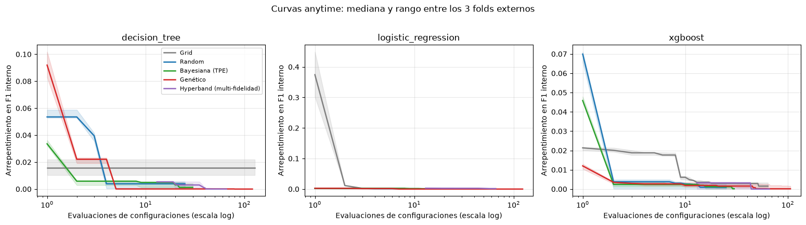
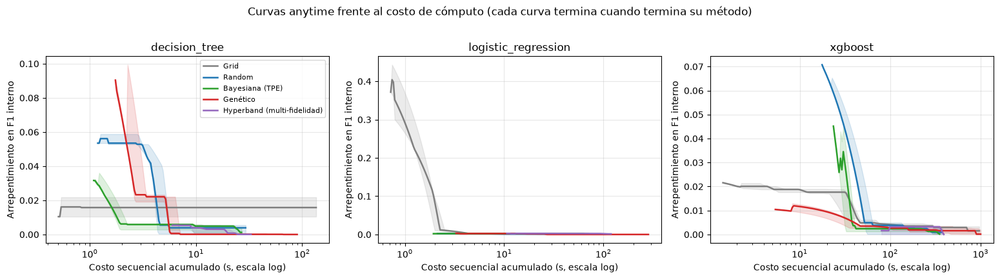

# 09. Curvas anytime y multi-fidelidad {#nb09}

```{r setup-nb09, include=FALSE}
knitr::opts_chunk$set(python.reticulate = FALSE)
BASE <- if (file.exists(file.path("R", "portar_notebook.R"))) "." else ".."
source(file.path(BASE, "R", "portar_notebook.R"))
```

<!-- nb:md cell=0 -->

La tabla maestra guarda el resultado final de cada búsqueda, pero no dice qué tan rápido encontró un buen candidato. Este notebook lo estudia de dos maneras:

1. **Curvas anytime** de los cuatro optimizadores del proyecto (grid, random, bayesiana con TPE y genético con DEAP): calidad del mejor candidato encontrado si la búsqueda se detuviera en cada punto, medida en número de evaluaciones y en costo de cómputo.
2. **Multi-fidelidad**: se implementó Hyperband desde cero, usando como fidelidad la fracción de filas de entrenamiento, y se compara con Random Search sobre el mismo espacio de búsqueda.

<!-- nb:code cell=1 -->
<details><summary>Código (24 líneas)</summary>

```{python nb09_c01, eval=FALSE}
import sys
from pathlib import Path

PROJECT_ROOT = Path.cwd().parent
if str(PROJECT_ROOT) not in sys.path:
    sys.path.insert(0, str(PROJECT_ROOT))

import warnings

import numpy as np
import pandas as pd
import matplotlib.pyplot as plt

warnings.filterwarnings("ignore", category=RuntimeWarning)  # nanmedian sobre tramos sin datos

from src import config
from src.anytime_study import load_anytime_results, METHODS

config.FIGURES_DIR.mkdir(parents=True, exist_ok=True)
traces, finals = load_anytime_results()
print(f"{traces.groupby(['model', 'fold', 'method']).ngroups} corridas, "
      f"{finals['model'].nunique()} modelos, folds {sorted(finals['fold'].unique())}, "
      f"semillas {sorted(finals['seed'].unique())}")
finals.groupby(["model", "method"]).size().unstack()
```

</details>

<!-- nb:text cell=1 -->
```text
45 corridas, 3 modelos, folds [np.int64(0), np.int64(1), np.int64(2)], semillas [np.int64(42)]
```

<!-- nb:table cell=1 -->
```{r nb09_t01_1, echo=FALSE}
mostrar_tabla("09_anytime_multifidelidad", "cell01_1.csv")
```

<!-- nb:md cell=2 -->
**Diseño del estudio.**
- Tres modelos: regresión logística, árbol de decisión y XGBoost, con `class_weight`. Se eligieron los más baratos de cada familia para poder repetir las búsquedas completas; no se corrió con Random Forest, KNN, Naive Bayes ni SVM.
- Los **3 primeros de los 5 folds externos** del protocolo (`StratifiedKFold(5, shuffle=True, random_state=42)`, folds 0, 1 y 2) y los mismos 5 folds internos. Se usa un subconjunto de folds de forma deliberada: repetir las búsquedas completas en los 5 folds multiplicaría el costo (XGBoost con grid o genético supera los 1000 s por corrida). La optimización solo ve el fold de entrenamiento externo. El fold de prueba se usa una sola vez al final, para el F1 externo del candidato elegido.
- Los presupuestos son los del resto del proyecto: Random 25 configuraciones, TPE 30 ensayos, genético con población 16 y 10 generaciones (el número de evaluaciones distintas es menor, porque los individuos que no cambian no se reevalúan) y grid con la grilla de cada modelo (8, 128 y 64 puntos). Hyperband usa `eta = 3`, fidelidad mínima 1/9 y 3 repeticiones del ciclo de brackets.
- Una sola semilla (42). Las 45 corridas son 3 modelos por 3 folds por 5 métodos.
- **Costo.** Se mide como la suma de las duraciones de cada evaluación (costo secuencial equivalente), que no depende del paralelismo.
- **Arrepentimiento.** Para cada modelo y fold, diferencia entre el mejor score interno visto por cualquier método a fidelidad completa y el mejor score del método hasta ese punto. Los scores son de validación interna, la misma que ve el optimizador.

<!-- nb:md cell=3 -->
## 1. Curvas anytime: arrepentimiento frente al número de evaluaciones

<!-- nb:code cell=4 -->
<details><summary>Código (59 líneas)</summary>

```{python nb09_c04, eval=FALSE}
COLORS = {
    "grid_search": "#7f7f7f", "random_search": "#1f77b4", "bayesian_optuna": "#2ca02c",
    "genetic_deap": "#d62728", "hyperband": "#9467bd",
}
LABELS = {
    "grid_search": "Grid", "random_search": "Random", "bayesian_optuna": "Bayesiana (TPE)",
    "genetic_deap": "Genético", "hyperband": "Hyperband (multi-fidelidad)",
}
models = sorted(traces["model"].unique())

# Referencia por (modelo, fold): el mejor score interno visto por CUALQUIER método
# a fidelidad completa. Arrepentimiento = referencia - mejor score hasta ese momento.
full = traces[traces["fidelity"] >= 1.0]
reference = full.groupby(["model", "fold"])["score"].max().rename("reference")
traces = traces.merge(reference, on=["model", "fold"])
traces["regret"] = traces["reference"] - traces["best_so_far"]


def median_curve(df, x_col, grid):
    """Mediana (y rango min-max) entre folds de la curva regret(x), evaluada en ``grid``.

    Cada corrida se lleva a una malla común con la última observación disponible
    (``best_so_far`` es una función escalonada); antes de su primera observación
    válida la curva no existe (NaN) y no se dibuja.
    """
    curves = []
    for _, run in df.groupby(["fold", "seed"]):
        run = run.dropna(subset=["regret"]).sort_values(x_col)
        if run.empty:
            continue
        values = np.interp(grid, run[x_col], run["regret"], left=np.nan)
        curves.append(values)
    arr = np.array(curves)
    return np.nanmedian(arr, axis=0), np.nanmin(arr, axis=0), np.nanmax(arr, axis=0)


fig, axes = plt.subplots(1, len(models), figsize=(5.2 * len(models), 4.2), sharey=False)
axes = np.atleast_1d(axes)
for ax, model in zip(axes, models):
    sub = traces[traces["model"] == model]
    grid = np.arange(1, int(sub["eval"].max()) + 1)
    for method in METHODS:
        run = sub[sub["method"] == method]
        if run.empty:
            continue
        med, lo, hi = median_curve(run, "eval", grid)
        last = int(run["eval"].max())
        ax.plot(grid[:last], med[:last], color=COLORS[method], label=LABELS[method], lw=1.8)
        ax.fill_between(grid[:last], lo[:last], hi[:last], color=COLORS[method], alpha=0.15)
    ax.set_xscale("log")
    ax.set_title(model)
    ax.set_xlabel("Evaluaciones de configuraciones (escala log)")
    ax.set_ylabel("Arrepentimiento en F1 interno")
    ax.grid(alpha=0.3)
axes[0].legend(fontsize=8)
fig.suptitle("Curvas anytime: mediana y rango entre los 3 folds externos", y=1.02)
fig.tight_layout()
fig.savefig(config.FIGURES_DIR / "anytime_vs_evaluations.png", dpi=150, bbox_inches="tight")
plt.show()
```

</details>

<!-- nb:img cell=4 -->


<!-- nb:md cell=5 -->
- **Regresión logística.** Todos los métodos llegan casi de inmediato a un arrepentimiento cercano a cero, porque el espacio de búsqueda es pequeño y la superficie es plana. Solo grid parte de un punto muy malo (cerca de 0.37), porque sus primeras configuraciones son malas, y lo corrige en dos evaluaciones.
- **Árbol de decisión.** Aquí hay diferencias. TPE es el que más rápido baja en pocas evaluaciones (de 0.034 a 0.006 en dos). Random y el genético empiezan peor (0.053 y 0.09) y necesitan unas 4 o 5 evaluaciones. **Grid no llega nunca**: su arrepentimiento se queda en cerca de 0.016 porque su grilla fija no contiene configuraciones tan buenas como las que encuentran los otros métodos, y es la única búsqueda que termina claramente por debajo de las demás en F1 externo (0.510 contra 0.520 a 0.525).
- **XGBoost.** El genético arranca mejor (0.012; probablemente porque su población inicial de 16 individuos incluye algún punto bueno), pero después avanza poco. Random y TPE parten de un arrepentimiento alto (0.07 y 0.046) y lo corrigen en las dos primeras evaluaciones. Grid se queda cerca de 0.02 hasta la evaluación 8 y baja después.
- En ningún modelo la ventaja de un método sobre otro persiste hasta el final: al agotar el presupuesto el arrepentimiento está por debajo de 0.004 en todos salvo grid en el árbol (0.016).

<!-- nb:md cell=6 -->
## 2. Curvas anytime frente al costo de cómputo

<!-- nb:code cell=7 -->
<details><summary>Código (24 líneas)</summary>

```{python nb09_c07, eval=FALSE}
fig, axes = plt.subplots(1, len(models), figsize=(5.2 * len(models), 4.2), sharey=False)
axes = np.atleast_1d(axes)
for ax, model in zip(axes, models):
    sub = traces[traces["model"] == model]
    grid = np.logspace(np.log10(max(sub["cum_cost_seconds"].min(), 0.1)), np.log10(sub["cum_cost_seconds"].max()), 200)
    for method in METHODS:
        run = sub[sub["method"] == method]
        if run.empty:
            continue
        med, lo, hi = median_curve(run, "cum_cost_seconds", grid)
        end = run.groupby(["fold", "seed"])["cum_cost_seconds"].max().min()
        keep = grid <= end
        ax.plot(grid[keep], med[keep], color=COLORS[method], label=LABELS[method], lw=1.8)
        ax.fill_between(grid[keep], lo[keep], hi[keep], color=COLORS[method], alpha=0.15)
    ax.set_xscale("log")
    ax.set_title(model)
    ax.set_xlabel("Costo secuencial acumulado (s, escala log)")
    ax.set_ylabel("Arrepentimiento en F1 interno")
    ax.grid(alpha=0.3)
axes[0].legend(fontsize=8)
fig.suptitle("Curvas anytime frente al costo de cómputo (cada curva termina cuando termina su método)", y=1.02)
fig.tight_layout()
fig.savefig(config.FIGURES_DIR / "anytime_vs_cost.png", dpi=150, bbox_inches="tight")
plt.show()
```

</details>

<!-- nb:img cell=7 -->


<!-- nb:md cell=8 -->
Al medir el costo en segundos el panorama cambia respecto al número de evaluaciones.
- El genético es el que más evaluaciones usa (entre 106 y 123), y en XGBoost su costo (1,443 s) es unas 2.5 veces el de Random (574 s) y 3.2 veces el de TPE (449 s) para un F1 externo igual (0.540 contra 0.538 y 0.542). Grid en XGBoost cuesta 1,182 s y tampoco mejora nada (0.540).
- TPE y Hyperband son las opciones más baratas en XGBoost (449 y 482 s) con F1 externo de 0.542 y 0.543, es decir, con un tercio del costo del genético y el mismo desempeño. Random queda en un punto intermedio.
- Esto es coherente con lo visto en la tabla maestra, donde los cuatro optimizadores son equivalentes en métrica: aquí se ve que lo que los distingue es el costo para llegar ahí, no el punto de llegada. Los costos son ruidosos: se midieron con varios procesos de estudio corriendo a la vez en el mismo equipo.

<!-- nb:md cell=9 -->
## 3. Resumen: costo para acercarse al mejor score y desempeño en el fold externo

<!-- nb:code cell=10 -->
<details><summary>Código (38 líneas)</summary>

```{python nb09_c10, eval=FALSE}
EPS = 0.002  # "cerca del mejor": a menos de 0.002 de F1 interno de la referencia


def cost_to_target(run):
    reached = run[run["regret"] <= EPS]
    return reached["cum_cost_seconds"].min() if not reached.empty else np.nan


def evals_to_target(run):
    reached = run[run["regret"] <= EPS]
    return reached["eval"].min() if not reached.empty else np.nan


rows = []
for (model, fold, seed, method), run in traces.groupby(["model", "fold", "seed", "method"]):
    rows.append({
        "model": model, "fold": fold, "seed": seed, "method": method,
        "cost_to_target_s": cost_to_target(run), "evals_to_target": evals_to_target(run),
        "final_regret": run.sort_values("eval")["regret"].iloc[-1],
    })
summary = pd.DataFrame(rows).merge(
    finals[["model", "fold", "seed", "method", "n_evaluations", "total_cost_seconds", "outer_f1", "outer_roc_auc"]],
    on=["model", "fold", "seed", "method"],
)
table = (
    summary.groupby(["model", "method"])
    .agg(
        evaluaciones=("n_evaluations", "mean"),
        costo_total_s=("total_cost_seconds", "mean"),
        costo_hasta_objetivo_s=("cost_to_target_s", "median"),
        corridas_que_llegan=("cost_to_target_s", lambda s: int(s.notna().sum())),
        arrepentimiento_final=("final_regret", "mean"),
        f1_externo_media=("outer_f1", "mean"),
        f1_externo_std=("outer_f1", lambda s: s.std(ddof=1)),
    )
    .round(4)
)
table
```

</details>

<!-- nb:table cell=10 -->
```{r nb09_t10_1, echo=FALSE}
mostrar_tabla("09_anytime_multifidelidad", "cell10_1.csv")
```

<!-- nb:md cell=11 -->
La columna `costo_hasta_objetivo_s` es la mediana del costo acumulado hasta quedar a menos de 0.002 de F1 interno de la referencia, y `corridas_que_llegan` dice en cuántos de los 3 folds se logra (cuando es 0 la mediana está vacía). Ninguna corrida de grid llega en el árbol de decisión, y en XGBoost llega en 2 de 3 folds (504 s). En XGBoost, el genético llega en 162 s (3 de 3), Random en 170 s (2 de 3), TPE en 262 s (3 de 3) e Hyperband en 385 s (3 de 3). Con 3 folds estos tiempos son indicativos, no concluyentes.

El F1 externo medio es prácticamente el mismo entre métodos dentro de cada modelo (por ejemplo, en XGBoost va de 0.538 a 0.543, con desviación entre folds de 0.003 a 0.010). Se confirma, sobre un fold de prueba que no usó la optimización, que el método de búsqueda no cambia el desempeño final.

<!-- nb:md cell=12 -->
## 4. Multi-fidelidad: Hyperband frente a Random Search con un costo comparable

<!-- nb:code cell=13 -->
<details><summary>Código (19 líneas)</summary>

```{python nb09_c13, eval=FALSE}
pair = finals[finals["method"].isin(["random_search", "hyperband"])].pivot_table(
    index=["model", "fold", "seed"], columns="method",
    values=["outer_f1", "total_cost_seconds", "inner_best_score"],
)
comp = pd.DataFrame({
    "F1 externo random": pair[("outer_f1", "random_search")],
    "F1 externo hyperband": pair[("outer_f1", "hyperband")],
    "dif. F1 (hyperband - random)": pair[("outer_f1", "hyperband")] - pair[("outer_f1", "random_search")],
    "costo random (s)": pair[("total_cost_seconds", "random_search")],
    "costo hyperband (s)": pair[("total_cost_seconds", "hyperband")],
})
comp["razón de costo (hyperband/random)"] = comp["costo hyperband (s)"] / comp["costo random (s)"]
display(comp.round(4))
print(
    "Diferencia media de F1 externo (hyperband - random): "
    f"{comp['dif. F1 (hyperband - random)'].mean():+.4f} "
    f"(desviación entre corridas {comp['dif. F1 (hyperband - random)'].std(ddof=1):.4f}, n={len(comp)})"
)
print(f"Razón de costo media: {comp['razón de costo (hyperband/random)'].mean():.2f}")
```

</details>

<!-- nb:table cell=13 -->
```{r nb09_t13_1, echo=FALSE}
mostrar_tabla("09_anytime_multifidelidad", "cell13_1.csv")
```

<!-- nb:text cell=13 -->
```text
Diferencia media de F1 externo (hyperband - random): +0.0022 (desviación entre corridas 0.0051, n=9)
Razón de costo media: 1.12
```

<!-- nb:md cell=14 -->
- Hyperband obtuvo un F1 externo medio 0.0022 mayor que Random Search (desviación entre corridas 0.0051, n = 9 pares modelo-fold). Fue mayor o igual en 7 de las 9 corridas y menor en dos. La diferencia es mucho menor que la desviación del F1 entre folds (0.003 a 0.013), así que no se puede decir que sea una mejora real, y las 9 corridas no son independientes (comparten datos).
- **El costo no fue igual.** Hyperband costó en promedio 1.12 veces lo que Random, con un rango de 0.49 a 1.49 (en un fold de XGBoost costó la mitad, y en la regresión logística hasta 1.49 veces). Una evaluación con 1/9 de las filas cuesta bastante más de 1/9 de una completa: hay costos fijos de preprocesamiento y de ajuste que no se reducen con los datos. Además, los costos medidos son ruidosos por el paralelismo entre procesos. Por eso la comparación es a costo comparable y no idéntico, y la ventaja de 0.0022 no puede atribuirse con seguridad a la multi-fidelidad.
- **No hubo aceleración hacia el objetivo.** En XGBoost, Hyperband necesitó más costo (385 s) que Random (170 s) para acercarse al mejor score. La multi-fidelidad ayuda cuando el costo crece con la fidelidad (por ejemplo, con conjuntos mucho más grandes o con iteraciones de boosting), y aquí con 30 mil filas y modelos baratos el ahorro es pequeño.
- Conclusión honesta: en este problema la multi-fidelidad es una alternativa válida, con un F1 externo igual o ligeramente mejor, pero no se demuestra una ventaja sobre Random Search.

<!-- nb:md cell=15 -->
## Limitaciones

- Solo 3 modelos de 7, una técnica de balanceo (`class_weight`), una semilla y 3 de los 5 folds externos. Con 3 folds por modelo no hay potencia para pruebas de hipótesis, por eso todo se reporta de forma descriptiva.
- Los scores de las curvas son de validación interna. Un candidato con mejor score interno no necesariamente es mejor en el fold de prueba, como muestran las diferencias mínimas de F1 externo.
- El costo se mide en segundos de una máquina concreta, con tres procesos de estudio corriendo a la vez, y es ruidoso.
- La fidelidad de Hyperband es el tamaño de la muestra de entrenamiento. Con otra fidelidad (por ejemplo, el número de árboles de XGBoost) el resultado podría ser distinto.
- Estas corridas repiten el protocolo y no forman parte de la tabla maestra. Para XGBoost con `class_weight` dan un F1 externo medio, sobre los folds 0 a 2, de 0.5417 (Optuna), 0.5398 (genético), 0.5396 (grid) y 0.5383 (random); no coinciden con la tabla maestra porque esta promedia los 5 folds.
